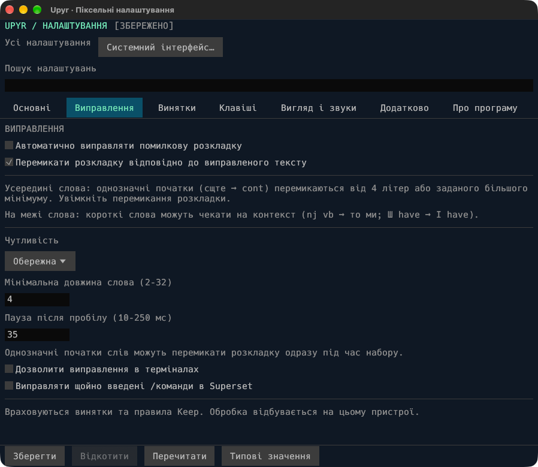

# Upyr

[](https://github.com/dmytro-yemelianov/upyr/releases)
[](https://crates.io/crates/upyr)
[](https://github.com/dmytro-yemelianov/upyr/releases)
[](docs/reference.md)
[](LICENSE)
[](docs/reference.md#build-and-run)

[](https://github.com/dmytro-yemelianov/upyr/actions/workflows/ci.yml?query=branch%3Amain)
[](https://github.com/dmytro-yemelianov/upyr/actions/workflows/security.yml?query=branch%3Amain)
[](docs/quality.md#readme-badges)
[](docs/quality.md#readme-badges)
[](SECURITY.md)

**Fix English ↔ Ukrainian text typed on the wrong keyboard layout.**
Upyr runs locally in your menu bar or system tray, with no account or telemetry.

`ghbdsn` → `привіт` · `руддщ` → `hello`

[Download](https://github.com/dmytro-yemelianov/upyr/releases) ·
[Try it in your browser](https://upyr.org/#try-it) ·
[Full reference](docs/reference.md) ·
[Report an issue](https://github.com/dmytro-yemelianov/upyr/issues/new/choose)

**Source version:** v0.6.0 preview. [Published downloads](https://github.com/dmytro-yemelianov/upyr/releases)
can lag the source version. macOS is the primary desktop target;
Windows and Linux/X11 are previews. Current macOS preview bundles are ad-hoc
signed and not notarized. See [installation notes](docs/reference.md#install-on-macos)
for details.

## What it does

- **Fix text on demand:** convert a selection or the word before the caret.
- **Correct while typing:** opt in to clear wrong-layout prefixes and word-boundary
  correction, with context for short words such as `nj vb` → `то ми`.
- **Keep control:** undo a correction, add exceptions, and pause correction per app.
- **Switch layouts:** follow converted text or use a clean Globe-key tap on macOS.
- **Choose feedback:** optional language flags, sound packs and a headphone limit.

Automatic correction is **off by default**. URLs, paths and known technical words
are protected; ambiguous input can stay unchanged.

## Install on macOS

1. Download the DMG or ZIP from [Releases](https://github.com/dmytro-yemelianov/upyr/releases).
2. Move **Upyr.app** to `/Applications` and open it.
3. Grant **Accessibility** access when prompted, then accept Upyr's restart offer.

Requires macOS 11+; release bundles support Apple Silicon and Intel.
Updates are available through Releases; the app does not check automatically.

## Everyday controls

| Action | Default shortcut on macOS |
| --- | --- |
| Convert selected text | `Cmd+Option+Space` |
| Fix the previous word | `Cmd+Option+Backspace` |
| Undo automatic correction | `Cmd+Option+Z` |

Use `Ctrl+Alt` for the conversion shortcuts on Windows and Linux.
On macOS, undo is available before further input or navigation, for up to 30
seconds. Backspace immediately after a correction can also revert it.

## Settings

Open **Settings** from the menu bar. The pixel-style editor has seven searchable
pages for correction, exceptions, shortcuts, flags, sounds and startup behavior.

Ukrainian is the default UI language. Select
**Основні → Мова інтерфейсу → English** to change it.
**Native interface…** opens the alternative desktop window.

<a href="site/assets/upyr-settings-pixel-uk.webp"></a>

[Configuration, custom rules and terminal options](docs/reference.md#configuration)

## Package-manager installs

```sh
brew tap dmytro-yemelianov/upyr
brew install upyr
brew services start upyr
```

Or install from source with `cargo install upyr --locked`.
[More installation options](docs/reference.md#package-manager-installs)

## Privacy and security

Text processing stays on your device. The runtime has no network client,
analytics or typing-history log. Learning saves rules and exceptions to your
local config; clipboard restoration is enabled by default.

[Privacy details](docs/reference.md#privacy-and-security) ·
[Quality and self-audit](docs/quality.md) ·
[Report a vulnerability](SECURITY.md) · [Third-party notices](THIRD_PARTY_NOTICES.md)

## Build and run

Requires Rust 1.87+.

```sh
cargo build --release --locked
./target/release/upyr doctor
./target/release/upyr settings
./target/release/upyr convert ghbdsn
```

[Platform dependencies and packaging](docs/reference.md#build-and-run) ·
[Architecture](docs/reference.md#architecture) ·
[Tests and engine details](docs/reference.md#how-correction-works)

<a id="globe-key-on-macos"></a>
<a id="how-correction-works"></a>
<a id="configuration"></a>
<a id="platform-status"></a>
<a id="architecture"></a>
<a id="versioning-and-releases"></a>
<a id="about-and-inspiration"></a>

## Further reading

[Configuration](docs/reference.md#configuration) ·
[How correction works](docs/reference.md#how-correction-works) ·
[Globe switching](docs/reference.md#globe-key-on-macos) ·
[Platform support](docs/reference.md#platform-status) ·
[Release history](CHANGELOG.md) ·
[Versioning](docs/reference.md#versioning-and-releases) ·
[About and inspiration](docs/reference.md#about-and-inspiration)

## License

[MIT](LICENSE). Contributions are welcome; see the [Code of Conduct](CODE_OF_CONDUCT.md).
